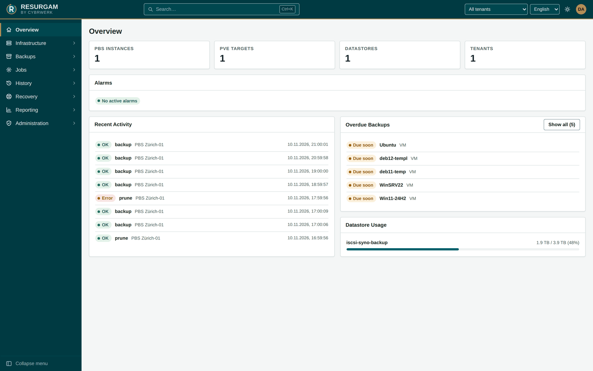
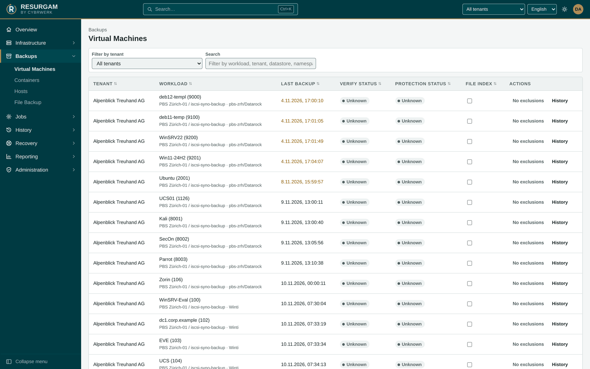
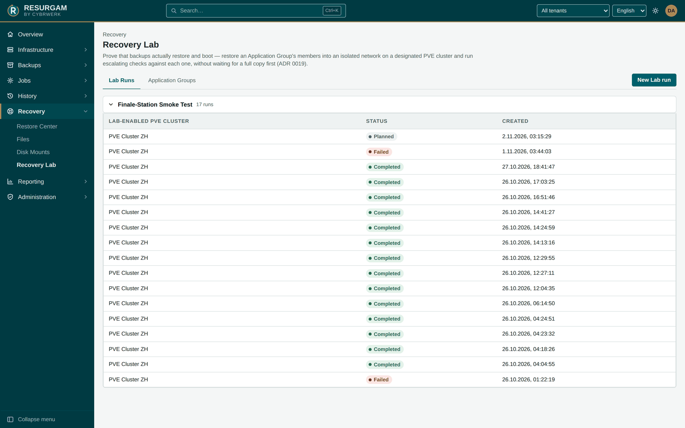
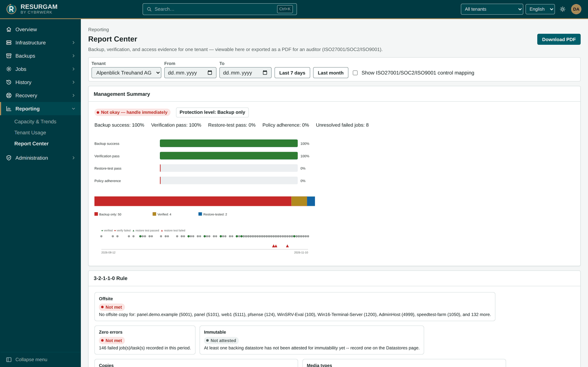
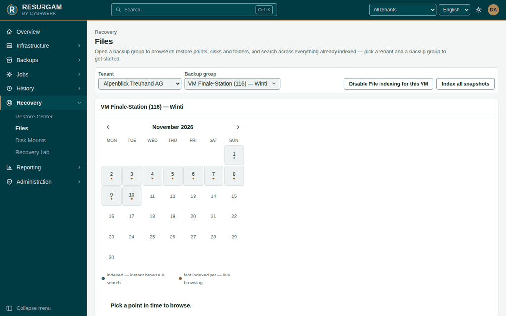

# RESURGAM Backup Center


*A Cyberwerk Project*

> Backups are promises. RESURGAM proves recovery.

[](https://github.com/cybrwerk/resurgam/actions/workflows/ci.yml)
[](./LICENSE)


> [!IMPORTANT]
> **RESURGAM is in public beta.** It runs against real PBS/PVE environments but is still young: expect rough edges and changes between releases, and run it next to your existing monitoring rather than as your only safety net. Read the [beta notes](./docs/BETA.md) (tested versions, known limitations, how to give feedback) before deploying.

## Quick install

Run this as root in the shell of a Proxmox VE node (PVE 8 or newer):

```sh
bash -c "$(curl -fsSL https://raw.githubusercontent.com/cybrwerk/resurgam/main/appliance/pve-install.sh)"
```

> [!TIP]
> The installer asks for the VM ID, storage, network bridge, VLAN and IP address (DHCP or static). It then downloads the latest release image, checks its checksum and creates and starts the appliance VM. When it finishes it shows the address of the setup wizard. To install without questions, set `RESURGAM_*` variables and add `--yes`; see [`appliance/DEPLOY.md`](./appliance/DEPLOY.md). Always read a script before you run it as root: [`appliance/pve-install.sh`](./appliance/pve-install.sh).

RESURGAM Backup Center is a multi-tenant management, monitoring, reporting, and restore control plane for multiple Proxmox Backup Server (PBS) and Proxmox VE (PVE) systems. It does not replace PBS or PVE — they remain the systems of record for backups and restores; RESURGAM adds inventory, cross-instance visibility, policy enforcement, guided/orchestrated restore, and recovery verification on top.

RESURGAM is an independent open-source project and is not affiliated with or endorsed by Proxmox.

The full product specification lives in [`Backup-Center-Appliance-Manifest.md`](./Backup-Center-Appliance-Manifest.md) — read that first for scope, architecture, data model, security requirements, and milestones. This README only tracks what actually exists in the repository today.

## What it does today

- **Inventory across many PBS/PVE systems:** connect PBS instances and PVE clusters (guided token setup, TLS pinning); the Collector syncs backup groups, snapshots and task history on a schedule; workloads get readable names from PBS notes / PVE.
- **Multi-tenancy and access:** tenants, global and per-tenant roles, OIDC SSO, local accounts with MFA (per user or required for everyone), break-glass emergency access, an append-only audit log.
- **Operations:** protection policies, verification/prune/sync views, PVE backup jobs (create, edit, "Run now" with a live log), capacity and usage history, pricing plans and tenant billing, alarms.
- **Restore:** file-level browse/download and ZIP export, a file index with search, guided restore plans (Restore Center), Instant Recovery (a VM runs straight from its backup within minutes and is moved to storage while it keeps running), and Disk Mounts (a VM backup's disks shared read-only over SMB/NFS for a limited time).
- **Recovery Lab:** boots backups zero-copy in an isolated network and proves they work with escalating checks, on demand or on a schedule; lab nodes are paired with a one-time code.
- **Reporting:** Recovery Evidence PDF reports with a permanent, checksummed archive.
- **Appliance:** a qcow2 image, signed-bundle updates (also fetched from a GitHub/GitLab release source), configuration export/import, white-label branding.

## Screenshots

| | |
| --- | --- |
|  |  |
| **Overview**: alarms, activity, overdue backups, capacity | **Inventory**: every protected workload across all PBS instances and tenants |
|  |  |
| **Recovery Lab**: backups booted in isolation and checked, on a schedule | **Report Center**: audit-ready Recovery Evidence, exported as PDF |

**File restore:** pick a restore point, browse the disk, and search filenames across every indexed snapshot.



<sub>Screenshots use demo data.</sub>

## Get started

1. Read the [beta notes](./docs/BETA.md).
2. Install the appliance with the [one-line installer](#quick-install) on a Proxmox VE node. Other ways to install: [`appliance/DEPLOY.md`](./appliance/DEPLOY.md). Release images and update bundles are on the [Releases page](https://github.com/cybrwerk/resurgam/releases).
3. Connect your first PBS in the setup wizard, then follow the [operator manual](./docs/manual/index.md).

Questions go to [Discussions](https://github.com/cybrwerk/resurgam/discussions), bugs to [Issues](https://github.com/cybrwerk/resurgam/issues/new/choose), and security problems to [private vulnerability reporting](./SECURITY.md). Contributions are welcome, see [CONTRIBUTING.md](./CONTRIBUTING.md).

Where to go next: [`CHANGELOG.md`](./CHANGELOG.md) (what changed per release), [`appliance/DEPLOY.md`](./appliance/DEPLOY.md) (install), [`appliance/UPDATE.md`](./appliance/UPDATE.md) (updates), [`docs/manual/index.md`](./docs/manual/index.md) (operator guide and developer setup), [`docs/architecture-and-dependencies.md`](./docs/architecture-and-dependencies.md) (architecture and dependencies).

## Repository layout

```text
backend/          Control Plane (FastAPI) — app skeleton, identity/tenancy model, PBS/PVE connection + datastore management, Collector
collector/        PBS/PVE inventory collector — placeholder; logic lives in backend/ for now (ADR 0006)
frontend/         React/TypeScript web UI (German/English, light/dark, white-label)
restore-worker/   PBS CLI wrappers (called in-process from backend/, ADR 0011), resurgam-lab-agent and resurgam-lab-prober (.deb packages)
appliance/        Appliance: Compose stack, Packer qcow2 build, signed update bundles + host updater (appliance/UPDATE.md)
docs/             Architecture, ADRs, operator manual, beta notes, assumptions log, README screenshots (docs/media/)
.github/          CI workflow, Dependabot, issue and pull request templates
logo/             Brand assets
VERSION           The release version (one per release; CHANGELOG.md has the notes)
```

## Development

Each component's own README documents its local setup.

```bash
# restore-worker
cd restore-worker && uv sync && uv run pytest -q

# backend (needs Docker for its dev Postgres — see backend/README.md)
cd backend
docker compose --env-file /dev/null -f docker-compose.dev.yml up -d
uv sync && uv run alembic upgrade head && uv run pytest -q

# frontend (needs the backend running — see frontend/README.md)
cd frontend
npm install && npm run test && npm run build
```

## Documentation conventions

This README, [`docs/architecture-and-dependencies.md`](./docs/architecture-and-dependencies.md), and [`docs/manual/index.md`](./docs/manual/index.md) are living documents updated alongside every change that affects structure, dependencies, or usage — not written once and left stale. Architecture Decision Records under [`docs/adr/`](./docs/adr/) are append-only: a decision is never rewritten — changes go into dated addenda or a superseding ADR. They record *why* a decision was made, not the current state.

## License

[GNU Affero General Public License v3.0 or later](./LICENSE) (SPDX: `AGPL-3.0-or-later`), matching the manifest's own preferred direction (§27.5) — a modified version run as a network service still has to make its source available to that service's users. Applies uniformly across `backend/`, `frontend/`, and `restore-worker/` (including `resurgam-lab-agent`); the manifest's own open question about licensing individual agent components more permissively was raised and not adopted, not overlooked.
